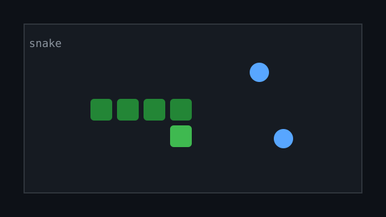
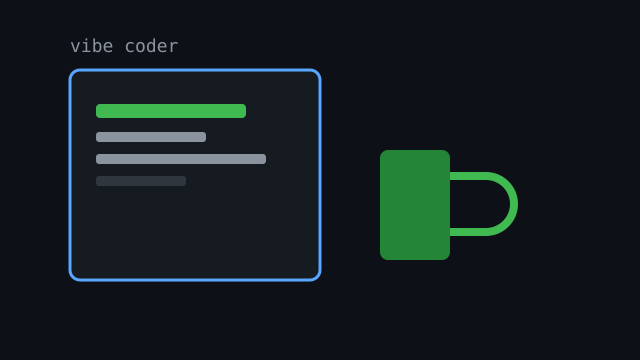
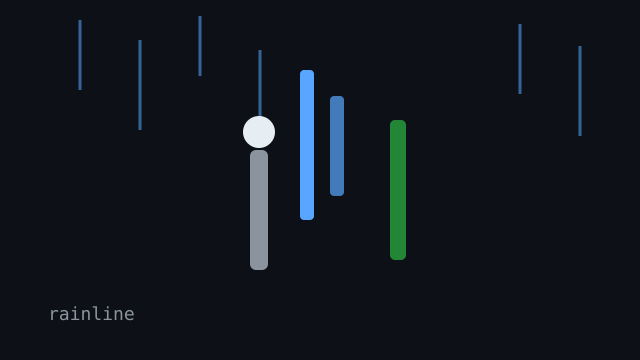
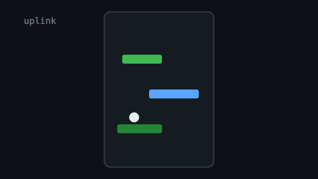

# Games

Small, free browser games. Each one is plain HTML, CSS, and JavaScript: no build step and no install. A new game lands on Mondays.

Open [index.html](index.html) and press Play, or open a game folder directly.

## Game of the week

### Fathom

[](games/fathom/media/gameplay.mp4)

Pilot a research lamp down a trench and log one animal from each ocean zone before the lamp goes dark. The preview is a real run. Select it for the MP4.

**Play:** [games/fathom/](games/fathom/)

**Controls:** `A` `D` or the arrows slide the lamp. `W` `S` move it in and out. On a touch screen, drag the stick or the trench. Steer into the glowing ring, and dodge everything else. `P` pauses. `R` starts over.

## All games

| Preview | Game | What you do | Controls |
|---|---|---|---|
| <a href="games/fathom/media/gameplay.mp4"></a> | [Fathom](games/fathom/) | Log one animal from each ocean zone before the lamp goes dark. | WASD or arrows. Drag the stick. Catch the ring. P pauses. |
| <a href="games/snake/"></a> | [Snake](games/snake/) | Eat the blue pellets. Avoid the walls and your tail. | Arrows or WASD. Swipe or the pad. Space pauses. |
| <a href="games/memory/"></a> | [Memory Match](games/memory/) | Flip eight pairs and finish in as few moves as you can. | Click, or arrows and Enter. |
| <a href="games/vibe-coder/"></a> | [Vibe Coder](games/vibe-coder/) | Clear glitchy landing-page shards and deploy before the coffee runs dry. | Click a prompt or press 1–8. Enter deploys. Space pauses. |
| <a href="games/rainline/"></a> | [Rainline](games/rainline/) | A stick vigilante on a rainy block. Chain strikes and clear the crew. | WASD and mouse. J strikes. Esc pauses. |
| <a href="games/uplink/"></a> | [Uplink](games/uplink/) | Climb a relay shaft. Ride lifts, zip to green rings, and light the dish. | A D or arrows. Space jumps. Q hooks. |
| <a href="games/slab/"></a> | [Slab](games/slab/) | Drop glass slabs in a kiln. Keep the overlap and catch the embers. | Space, click, or Drop. P pauses. |

## Run locally

```bash
git clone https://github.com/alexnaughtonjr/games.git
cd games
python3 -m http.server 8080
```

Open <http://localhost:8080/>. Opening `index.html` from the file system also works. Snake and Memory Match stay fully offline. The 3D games need WebGL. Three.js is vendored in the repo, so play does not call a CDN.

On the collection page, press 1–7 to open Snake, Memory Match, Vibe Coder, Rainline, Uplink, Slab, or Fathom.

## Add a Monday game

Each mini-game lives in `games/<slug>/`:

| File | Purpose |
|---|---|
| `index.html` | The game. This is the page people open. |
| `README.md` | Name, one-line pitch, controls, and the preview. |
| `media/preview.gif` | Short looping capture. |
| `media/gameplay.mp4` | The same capture, about 5–15 seconds. Link the GIF to this file. |
| `game.js`, `style.css` | Source, when the game is not a single file. |

Shared Three.js, bloom, and sounds live in `shared/` for games that want them. A game that already vendors its own Three.js keeps that copy in its folder.

Add a row to the gallery above and a card on [index.html](index.html). Product-lab pages stay at the repository root and open from [lab.html](lab.html).

## Theme

Pages use the GitHub Primer dark palette:

- Page background `#0d1117`
- Panels `#161b22`
- Green accent `#238636`
- Blue accent `#58a6ff`

Body text uses Inter, then the system UI stack. Titles, scores, and labels use JetBrains Mono, ui-monospace, SFMono-Regular, Menlo, monospace. Snake, Memory Match, Rainline, Uplink, Slab, and Fathom do not download fonts. Vibe Coder requests Inter and JetBrains Mono from Google Fonts and falls back to that same stack.

## GitHub Pages

`.github/workflows/pages.yml` publishes the repository root on every push to `main`. When Pages is enabled with GitHub Actions as the source, the collection is at `https://alexnaughtonjr.github.io/games/` and Fathom is at `https://alexnaughtonjr.github.io/games/games/fathom/`.
