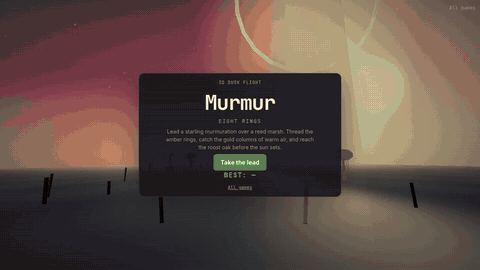
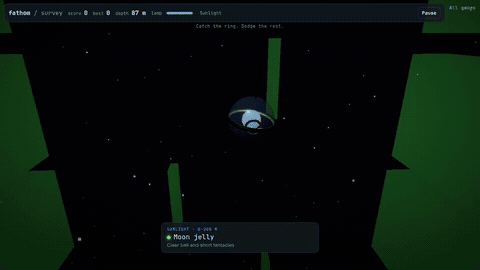
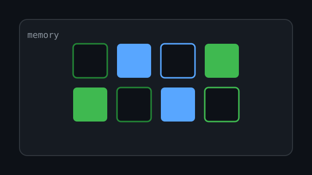
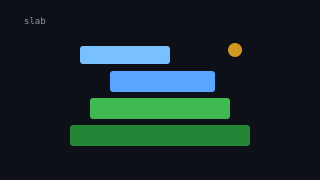

# Games

Small, free browser games. Each one is plain HTML, CSS, and JavaScript: no build step and no install. A new game lands on Mondays.

Open [index.html](index.html) and press Play, or open a game folder directly.

## Play live, free in your browser

**[▶ Play the full collection](https://raw.githack.com/alexnaughtonjr/games/main/index.html)**

- [Murmur](https://raw.githack.com/alexnaughtonjr/games/main/games/murmur/index.html)
- [Fathom](https://raw.githack.com/alexnaughtonjr/games/main/games/fathom/index.html)
- [Snake](https://raw.githack.com/alexnaughtonjr/games/main/games/snake/index.html)
- [Memory Match](https://raw.githack.com/alexnaughtonjr/games/main/games/memory/index.html)
- [Vibe Coder](https://raw.githack.com/alexnaughtonjr/games/main/games/vibe-coder/index.html)
- [Rainline](https://raw.githack.com/alexnaughtonjr/games/main/games/rainline/index.html)
- [Uplink](https://raw.githack.com/alexnaughtonjr/games/main/games/uplink/index.html)
- [Slab](https://raw.githack.com/alexnaughtonjr/games/main/games/slab/index.html)

No install and no sign-up. The 3D games need WebGL.

## Game of the week

### Murmur

[](games/murmur/media/gameplay.mp4)

Lead a starling murmuration over a reed marsh. Thread eight amber rings, keep the flock together, and reach the roost oak before the sun sets. The preview is a real flight. Select it for the MP4.

**Play:** [Play Murmur live](https://raw.githack.com/alexnaughtonjr/games/main/games/murmur/index.html) · [source](games/murmur/)

**Controls:** `A` `D` or the arrows bank. `W` `S` climb and dive. Move the mouse, or drag the stick. Fly through the amber rings and dodge the posts with red ribbons. `Space` calls the flock tight. `P` pauses. `R` starts over.

## All games

| Preview | Game | What you do | Controls |
|---|---|---|---|
| <a href="games/murmur/media/gameplay.mp4"></a> | [Murmur](https://raw.githack.com/alexnaughtonjr/games/main/games/murmur/index.html) ([source](games/murmur/)) | Lead a starling flock through eight rings and reach the roost before sunset. | WASD or arrows. Mouse or the stick. Space calls. P pauses. |
| <a href="games/fathom/media/gameplay.mp4"></a> | [Fathom](https://raw.githack.com/alexnaughtonjr/games/main/games/fathom/index.html) ([source](games/fathom/)) | Log one animal from each ocean zone before the lamp goes dark. | WASD or arrows. Drag the stick. Catch the ring. P pauses. |
| <a href="games/snake/"></a> | [Snake](https://raw.githack.com/alexnaughtonjr/games/main/games/snake/index.html) ([source](games/snake/)) | Eat the blue pellets. Avoid the walls and your tail. | Arrows or WASD. Swipe or the pad. Space pauses. |
| <a href="games/memory/"></a> | [Memory Match](https://raw.githack.com/alexnaughtonjr/games/main/games/memory/index.html) ([source](games/memory/)) | Flip eight pairs and finish in as few moves as you can. | Click, or arrows and Enter. |
| <a href="games/vibe-coder/"></a> | [Vibe Coder](https://raw.githack.com/alexnaughtonjr/games/main/games/vibe-coder/index.html) ([source](games/vibe-coder/)) | Clear glitchy landing-page shards and deploy before the coffee runs dry. | Click a prompt or press 1–8. Enter deploys. Space pauses. |
| <a href="games/rainline/"></a> | [Rainline](https://raw.githack.com/alexnaughtonjr/games/main/games/rainline/index.html) ([source](games/rainline/)) | A stick vigilante on a rainy block. Chain strikes and clear the crew. | WASD and mouse. J strikes. Esc pauses. |
| <a href="games/uplink/"></a> | [Uplink](https://raw.githack.com/alexnaughtonjr/games/main/games/uplink/index.html) ([source](games/uplink/)) | Climb a relay shaft. Ride lifts, zip to green rings, and light the dish. | A D or arrows. Space jumps. Q hooks. |
| <a href="games/slab/"></a> | [Slab](https://raw.githack.com/alexnaughtonjr/games/main/games/slab/index.html) ([source](games/slab/)) | Drop glass slabs in a kiln. Keep the overlap and catch the embers. | Space, click, or Drop. P pauses. |

## Run locally

```bash
git clone https://github.com/alexnaughtonjr/games.git
cd games
python3 -m http.server 8080
```

Open <http://localhost:8080/>. `npx serve .` serves the same tree. Opening `index.html` from the file system also works for the vendored games. Snake and Memory Match stay fully offline. The 3D games need WebGL. Fathom, Rainline, Uplink, Slab, and Vibe Coder ship a copy of Three.js in the repo. Murmur loads Three.js as an ES module from jsDelivr, so that game needs a network connection and a local server.

On the collection page, press 1–8 to open Snake, Memory Match, Vibe Coder, Rainline, Uplink, Slab, Fathom, or Murmur.

## Add a Monday game

Each mini-game lives in `games/<slug>/`:

| File | Purpose |
|---|---|
| `index.html` | The game. This is the page people open. |
| `README.md` | Name, one-line pitch, controls, and the preview. |
| `media/preview.gif` | Short looping capture. |
| `media/gameplay.mp4` | The same capture, about 5–15 seconds. Link the GIF to this file. |
| `game.js`, `style.css` | Source, when the game is not a single file. |

Shared Three.js, bloom, and sounds live in `shared/` for games that want them. A game that already vendors its own Three.js keeps that copy in its folder.

Add a row to the gallery above and a card on [index.html](index.html). Product-lab pages stay at the repository root and open from [lab.html](lab.html).

## Theme

Pages use the GitHub Primer dark palette:

- Page background `#0d1117`
- Panels `#161b22`
- Green accent `#238636`
- Blue accent `#58a6ff`

Body text uses Inter, then the system UI stack. Titles, scores, and labels use JetBrains Mono, ui-monospace, SFMono-Regular, Menlo, monospace. Snake, Memory Match, Rainline, Uplink, Slab, Fathom, and Murmur do not download fonts. Vibe Coder requests Inter and JetBrains Mono from Google Fonts and falls back to that same stack.
