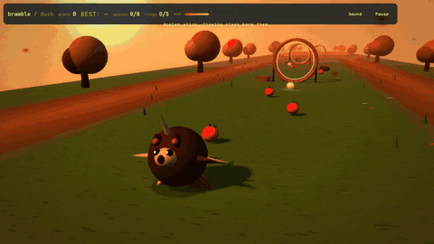

# Bramble

Roll a hedgehog through a golden-hour orchard. Apples stick to your spines. Shake them through five wicker rings, hop the briars, and reach the burrow before the sun sets. The preview is a real roll. Select it for the MP4.

**[▶ Play now in your browser](https://raw.githack.com/alexnaughtonjr/games/main/games/bramble/index.html)**

Free, no install.

[](media/gameplay.mp4)

## Play

**[▶ Play now in your browser](https://raw.githack.com/alexnaughtonjr/games/main/games/bramble/index.html)**

Free, no install. WebGL is required. Three.js is the shared copy at `../../shared/vendor/three.min.js`. Bloom comes from `../../shared/bloom.js`. Nothing is loaded from a CDN, and there is no build step.

### Run locally (optional)

From the repository root:

```bash
python3 -m http.server 8080
```

Open <http://localhost:8080/games/bramble/>. `npx serve .` works the same way.

## Controls

- `A` `D` or the left and right arrows steer. `W` or the up arrow speeds up. `S` or the down arrow slows down.
- On a touch screen, drag the stick or drag on the orchard. Hop is the round button.
- Roll over an apple and it sticks to your spines. You can carry eight. A gold apple is worth more when a ring banks it, and it puts 1.5 seconds back on the sun, up to a full meter.
- A glowing wicker ring banks every apple you are carrying. A red apple is 100. A gold apple is 250. Four or more at once adds 80 for each apple past the third.
- Dark briars knock off up to two apples and slow the roll. `Space` hops. A hop clears a briar.
- Reach the warm burrow before the sun meter empties. Leftover daylight is 70 a second, and each apple still on your spines is 50.
- `P` or `Esc` pauses. `R` starts the roll over. `M` mutes.

## High scores

The best score stays in this browser only, on this device (`localStorage` key `hivemind.highscore.bramble`). Higher is better. Ring banks add points as you roll. Reaching the burrow adds the daylight and leftover-apple bonus. If the sun meter empties, the run keeps the banked points only. The best is shown in the HUD during the roll and on the title card. Beating it paints NEW HIGH SCORE! on the end screen. An older save under `games.bramble.best` is copied across the first time the game looks.

## Scoring

Each red apple banked at a ring is worth 100, and each gold apple is worth 250. Banking four or more at once adds 80 for every apple past the third. A gold apple also returns 1.5 seconds of daylight, and the sun meter does not rise past full. At the burrow, each second of daylight left is worth 70, and each apple still on your spines is worth 50. A briar drops up to two apples ahead of you and slows the roll. Those apples can be stuck again. If the orchard goes dark, the run ends with the ring points only.
