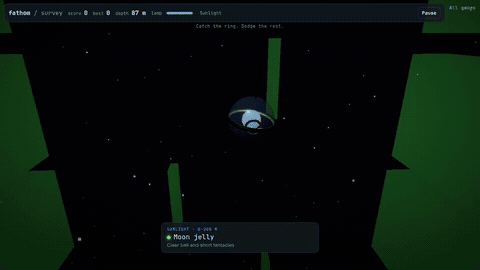

# Fathom

Pilot a research lamp down a dark trench and log one animal from each ocean zone before the lamp goes dark.

**[▶ Play now in your browser](https://raw.githack.com/alexnaughtonjr/HIVEMIND/main/games/fathom/index.html)**

Free, no install.

## Play

**[▶ Play now in your browser](https://raw.githack.com/alexnaughtonjr/HIVEMIND/main/games/fathom/index.html)**

Free, no install. WebGL is required. Three.js is the shared copy at `../../shared/vendor/three.min.js`. Bloom comes from `../../shared/bloom.js`, and the sounds come from `../../shared/juice.js`. Nothing is loaded from a CDN, and there is no build step.

### Run locally (optional)

Open `index.html` in a browser.

## Controls

- `A` `D` or the arrow keys slide the lamp. `W` `S` move it in and out of the trench.
- On a touch screen, drag the stick, or drag on the trench itself.
- The glowing ring is the animal on the field card. Steer into it to file that zone.
- Other animals and rock spires drain the lamp. From the midnight zone down, a hot vent pushes the lamp sideways.
- Each logged animal restores charge. Five zones complete the survey, and leftover charge becomes bonus points.
- `P` or `Esc` pauses. `R` starts a fresh survey.

## High scores

The best score stays in this browser only, on this device (`localStorage` key `hivemind.highscore.fathom`). Higher is better. Each logged animal scores 100 plus 30 times the zone index, leftover lamp charge adds 4 points per unit, and a collision costs 15. The saved number is the score when the survey ends, because hits can spend points you had already earned. An older save under `games.fathom.best` is copied across the first time the game looks.

## Zones

| Zone | Depth | Log this |
|---|---|---|
| Sunlight | 0–200 m | Moon jelly |
| Twilight | 200–1,000 m | Lanternfish |
| Midnight | 1,000–4,000 m | Angler |
| Abyss | 4,000–6,000 m | Dumbo octopus |
| Hadal | below 6,000 m | Vent worm |
