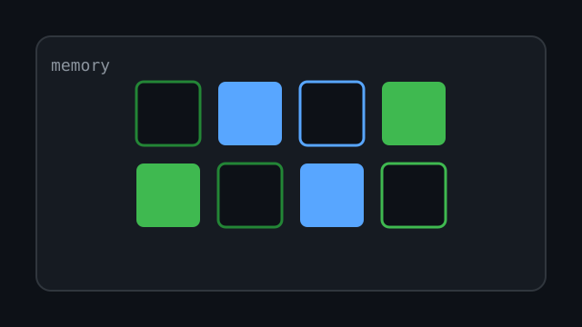

# Memory Match

Sixteen cards, eight pairs. Flip two at a time and remember where each shape landed. The clock starts on the first flip.

## Play

Open `index.html`. No build step, no network, and the file protocol works.

## Controls

- Tap a card, or move with the arrow keys and press Enter or Space.
- New game deals a fresh board.
- Fewest moves (`games.memory.bestMoves`) and best time (`games.memory.bestTimeMs`) stay in this browser.
