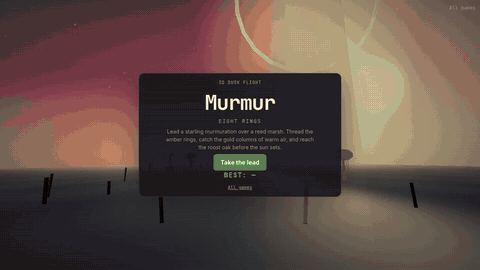

# Murmur

Lead a starling murmuration over a reed marsh at dusk. Thread eight amber rings, catch the gold columns of warm air, slip the marsh harriers, and reach the roost oak before the sun sets. The preview is a real flight. Select it for the MP4.

**[▶ Play now in your browser](https://raw.githack.com/alexnaughtonjr/HIVEMIND/main/games/murmur/index.html)**

Free, no install.

[](media/gameplay.mp4)

## Play

**[▶ Play now in your browser](https://raw.githack.com/alexnaughtonjr/HIVEMIND/main/games/murmur/index.html)**

Free, no install. WebGL is required. Three.js is the shared copy at `../../shared/vendor/three.min.js`. Nothing is loaded from a CDN, and there is no build step.

### Run locally (optional)

From the repository root:

```bash
python3 -m http.server 8080
```

Open <http://localhost:8080/games/murmur/>. `npx serve .` works the same way.

## Controls

- `A` `D` or the left and right arrows bank. `W` `S` or the up and down arrows climb and dive.
- Move the mouse to steer. On a touch screen, drag the stick or the marsh.
- Fly the lead starling through each amber ring. A ring folds four more birds into the flock and scores 300.
- Gold columns are warm air. Fly through one to score 80 and put 2.6 seconds back on the sun, up to a full meter.
- Dark posts marked with a red ribbon snag the flock. A marsh harrier patrols each red line: meeting it scatters three starlings and steals 2.2 seconds of daylight. `Space` calls the birds tight, shortens a snag, and makes the harrier easier to slip.
- Reach the roost oak while at least one starling is still with you, before the sun meter empties.
- `P` or `Esc` pauses. `R` starts the flight over. `M` mutes the chirps.

## High scores

The best score stays in this browser only, on this device (`localStorage` key `hivemind.highscore.murmur`). Higher is better. Each ring is 300 and each warm column is 80, added as you fly. Reaching the oak adds 80 for every starling still with you and 30 for each second of daylight left. A scattered or darkened run keeps the ring and warm-air points only. The best is shown in the HUD during the flight and on the title card. Beating it paints NEW HIGH SCORE! on the end screen. An older save under `games.murmur.best` is copied across the first time the game looks.

## Scoring

Each ring is worth 300 points, and each warm column is worth 80, both added as you fly. A warm column also returns 2.6 seconds of daylight, and the sun meter does not rise past full. At the oak, every starling still in the air is worth 80, and each second of daylight left is worth 30. A harrier scatters three starlings and takes 2.2 seconds off the sun. If the flock scatters or the marsh goes dark, the run ends with the ring and warm-air points only.
