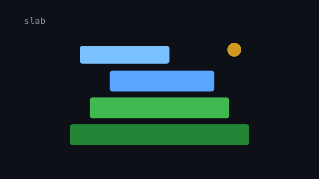

# Slab

A 3D kiln stack. Drop a sliding glass slab, keep the overlap, and catch the amber embers.

The slab alternates between the side axis and the depth axis. Anything that hangs off the tower is cut away. A clean miss ends the run. Land almost flush and the tower keeps its full size.

**[▶ Play now in your browser](https://raw.githack.com/alexnaughtonjr/games/main/games/slab/index.html)**

Free, no install.

## Play

**[▶ Play now in your browser](https://raw.githack.com/alexnaughtonjr/games/main/games/slab/index.html)**

Free, no install. WebGL is required. Three.js is the shared copy at `../../shared/vendor/three.min.js`. Bloom comes from `../../shared/bloom.js`, and the drop sounds come from `../../shared/juice.js`. Nothing is loaded from a CDN, and there is no build step.

### Run locally (optional)

Open `index.html` in a browser.

## Controls

- Space, click, or tap drops the slab. On a touch screen, use Drop
- The pale mark on the tower shows where the slab will land
- Each floor is 10 points. A perfect land adds 15 points times the streak
- An amber ember appears every third floor. Cover it for 50 points
- `P` or `Esc` pauses. `R` starts a fresh tower

## High scores

The best score stays in this browser only, on this device (`localStorage` key `hivemind.highscore.slab`). Higher is better: 10 points per floor, 15 times the streak for a perfect land, and 50 for an ember. An older save under `games.slab.best` is copied across the first time the game looks.
