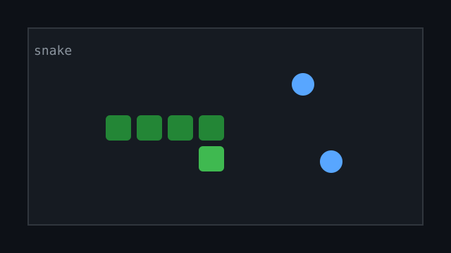

# Snake

Steer a snake around a 20×20 board and eat the blue pellets. Each pellet is worth 10 points, and the snake speeds up as the score climbs. Hitting a wall or your own tail ends the run. Filling the board wins it.

**[▶ Play now in your browser](https://raw.githack.com/alexnaughtonjr/games/main/games/snake/index.html)**

Free, no install.

## Play

**[▶ Play now in your browser](https://raw.githack.com/alexnaughtonjr/games/main/games/snake/index.html)**

Free, no install.

### Run locally (optional)

Open `index.html`. No build step, no network, and the file protocol works.

## Controls

- Arrow keys or WASD choose the direction and start the run. On a touch screen, swipe the board or use the on-screen pad.
- A second direction pressed before the next step is kept. A turn that would reverse into the tail is ignored.
- Space or P pauses. R or Restart returns to the ready screen.

## High scores

The best score stays in this browser only, on this device (`localStorage` key `hivemind.highscore.snake`). Higher is better. Each pellet is 10 points. An older save under `games.snake.highScore` is copied across the first time the game looks.
