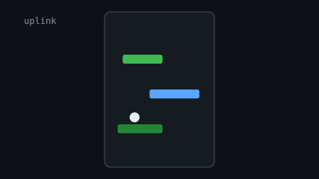

# Uplink

Free custom game for Alexander Haislip. A 3D courier climb up a dark relay shaft.

Jump a generated service stair cut into the shaft wall, pocket the blue cores, and land on the green relay pad. Striped lifts carry you, gust vents shove sideways, and green rings take a grapple zip. Missing a ledge ends the run.

**[▶ Play now in your browser](https://raw.githack.com/alexnaughtonjr/games/main/games/uplink/index.html)**

Free, no install.

## Play

**[▶ Play now in your browser](https://raw.githack.com/alexnaughtonjr/games/main/games/uplink/index.html)**

Free, no install. WebGL is required. Three.js is the shared copy at `../../shared/vendor/three.min.js`, and bloom comes from `../../shared/bloom.js`. Nothing is loaded from a CDN, and there is no build step.

### Run locally (optional)

Open `index.html` in a browser.

## Controls

- `A` `D` or the arrow keys move. On a touch screen, drag the stick
- `Space`, `W`, `Up`, or Jump. Release early for a shorter hop
- `Q` or Hook zips to a green ring in reach. The line then cools down
- Blue cores are worth 100. Height above the floor adds 10 points per meter
- `P` or `Esc` pauses the shaft. `R` or Restart builds a new one
- Green chevrons are boost pads. Red lips crumble after you land. Blue slabs slide under you
- Striped lifts ride up and down on a cable. Cyan gust vents push you sideways
- The courier carries a lamp. A soft shadow and bloom follow the climb. Dust drifts in the shaft, and jumps throw a ring of sparks
- Green bulbs on the left rail light up to the best height of this run
- The camera leads upward on the way up and dips when you fall
- Blue beacon platforms save a checkpoint. Red sweep beams and a long fall return you there
- Before the first beacon, a miss ends the run
- The top of the shaft is a relay dish. Landing on that pad wins

## High scores

The best score stays in this browser only, on this device (`localStorage` key `hivemind.highscore.uplink`). Higher is better. Height above the floor is 10 points per meter, and each blue core is 100. An older save under `games.uplink.best` is copied across the first time the game looks.
