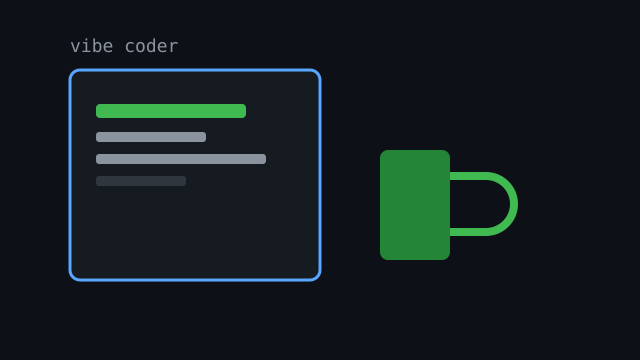

# Vibe Coder: Ship Before Coffee Dies

Free custom game for Alexander Haislip — week two of the weekly free game drop, now rebuilt in **3D** with Three.js.

Chain the right AI prompts, clear glitchy landing-page shards on a neon Primer desk, and deploy before the coffee in the 3D mug runs dry.

**[▶ Play now in your browser](https://raw.githack.com/alexnaughtonjr/HIVEMIND/main/games/vibe-coder/index.html)**

Free, no install.

## How to play

**[▶ Play now in your browser](https://raw.githack.com/alexnaughtonjr/HIVEMIND/main/games/vibe-coder/index.html)**

Free, no install. WebGL is required.

- Each of 5 sprints ships a broken page (misaligned button, low contrast, overflowing headline, missing nav, stuck cookie modal, Comic Sans subtitle, broken hero image, neon flashbang background).
- Click / tap a prompt card or press **1–8** to apply it. Real fixes clear a glitch and build a combo (up to x5).
- Junk prompts ("Rewrite the whole thing in Rust") cost 8 seconds of coffee and reset your combo.
- One emergency **Sip** per sprint (**S**) adds 10 seconds — watch the liquid level in the 3D mug.
- **Deploy** (**Enter**) once every glitch is fixed. Deploying early costs 5 seconds. Leftover coffee becomes bonus points.
- **Space** or **P** pauses the coffee timer and freezes the 3D desk (steam, shards, and camera). **R** restarts the run. Resume with Space, P, Esc, or Enter.

### Run locally (optional)

Open `index.html` in any modern browser (WebGL). For itch.io, upload the zip with `index.html` at the zip root.

## High scores

The best score stays in this browser only, on this device (`localStorage` key `hivemind.highscore.vibe-coder`). Higher is better. Real fixes score 100 times the combo, and leftover coffee at deploy is worth 10 points a second. An older save under `games.vibeCoder.highScore` is copied across the first time the game looks.

## Tech
- **Three.js** (vendored locally at `vendor/three.min.js`) — offline-safe, no CDN required at play time.
- HTML / CSS HUD overlay (GitHub Primer dark: `#0d1117` / `#161b22`, accents `#238636` / `#58a6ff`, JetBrains Mono + Inter / system fonts).
- 3D scene: Primer desk, floating landing-page panels, glitch shards, coffee mug with steam, subtle camera motion.

## License
Free to play and share.
